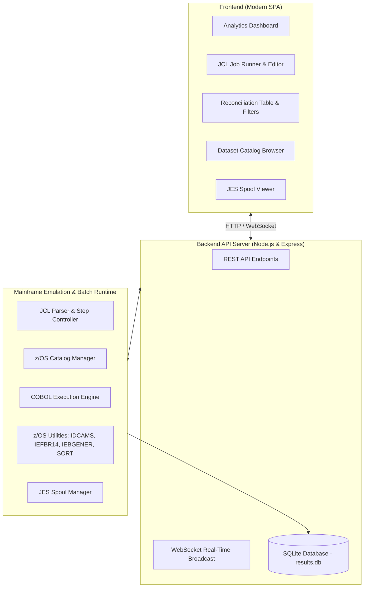

# Mainframe Bank — Transaction Reconciliation System

An enterprise-grade Banking Transaction Reconciliation platform featuring an IBM z/OS Mainframe emulation engine, COBOL batch processing pipeline, JCL job scheduler, real-time WebSocket job streaming, and an analytics dashboard.

---

## 📋 Table of Contents

- [Overview](#overview)
- [Architecture & Tech Stack](#architecture--tech-stack)
- [System Features](#system-features)
- [Batch Pipeline & COBOL Programs](#batch-pipeline--cobol-programs)
- [Mainframe Emulation Engine](#mainframe-emulation-engine)
- [Project Directory Structure](#project-directory-structure)
- [Prerequisites & Installation](#prerequisites--installation)
- [Running the Application](#running-the-application)
- [Automated Test Suite](#automated-test-suite)
- [API Reference](#api-reference)
- [WebSocket Protocol](#websocket-protocol)
- [License](#license)

---

## 🏛️ Overview

In core enterprise banking systems, daily financial transactions from external payment networks, ATMs, SWIFT/ACH networks, and internal core banking ledger systems must be reconciled in high-throughput nightly batch jobs. 

This project simulates and executes an end-to-end z/OS Mainframe transaction reconciliation workflow with authentic JCL job streams, COBOL compilation and execution units, catalog datasets (PS, PDS, GDG, VSAM KSDS), JES spool logging, and an interactive modern web UI.

---

## ⚡ Architecture & Tech Stack



### Technology Highlights
- **Frontend:** Vanilla HTML5, Modern CSS Design System (Dark Glassmorphism, CSS Grid/Flexbox), Vanilla JavaScript (ES6+), WebSocket client.
- **Backend:** Node.js, Express.js, WebSocket (`ws`), Better-SQLite3, Multer.
- **Mainframe Runtime:** Custom JCL parser, z/OS Catalog Engine (DISP, DCB, GDG generations, VSAM), JES2/JES3 Spool subsystem, COBOL batch runner.

---

## ✨ System Features

1. **Interactive Dashboard:** High-level reconciliation KPI cards (Total, Matched, Amount Mismatches, Missing in Bank/Core, Duplicates) with financial volume aggregations.
2. **JCL Job Submission & Editor:** Submit and monitor standard IBM JCL jobs (`BANKRECN`, `ALLOCDSN`, `DEFVSAM`, `DEFGDG`, `INITVSAM`, `COPYDSN`, `DELETDSN`, `RENAMDSN`, `CATLGDSN`) or custom user-submitted JCL.
3. **Real-time Live Job Stepper:** Dynamic execution timeline showing individual job steps (`STEP01` through `STEP06`), return codes (`RC=0000`, `RC=0004`, `RC=0008`, `ABEND`), and live console feeds via WebSocket.
4. **Reconciliation Analysis & Drill-down:** Filterable transaction viewer with status filters, account search, and discrepancy flags.
5. **Dataset Catalog & VSAM Browser:** Explore allocated Sequential (PS), Partitioned (PDS), Generation Data Groups (GDG), and VSAM KSDS files.
6. **JES Spool Viewer:** Complete access to generated `JESMSGLG`, `JESJCL`, `JESYSMSG`, `SYSOUT`, and `SYSPRINT` outputs.
7. **Audit Trail:** Immutable job execution history with execution timestamps, elapsed run times, and max return codes.

---

## ⚙️ Batch Pipeline & COBOL Programs

The core nightly reconciliation job stream (`BANKRECN.jcl.tmpl`) orchestrates the following execution steps:

| Step | Program / Utility | Description |
| :--- | :--- | :--- |
| **STEP01** | `IEFBR14` | Cleans up pre-existing temporary and output datasets before execution. |
| **STEP02** | `IDCAMS` | Defines and initializes VSAM KSDS clusters and catalog entries. |
| **STEP03** | `TXNVALID` | Validates raw feeds from Core Banking & Bank Channel files. Filters corrupt records to error files. |
| **STEP04** | `SORT` | Sorts Core Banking and Bank Channel transactions by Account Number, Transaction Date, and ID. |
| **STEP05** | `RECONCIL` | Dual-cursor reconciliation engine matching debit/credit entries, identifying status and variance. |
| **STEP06** | `RECLOAD` & `RECRPT` | Loads reconciled results into persistence and formats formatted accounting discrepancy reports. |

### COBOL Source Files & Copybooks (`mainframe/cobol/`):
- `ACCTINIT.cbl`: Master account dataset generator.
- `TXNVALID.cbl`: Transaction syntax and schema validation module.
- `RECONCIL.cbl`: Two-way ledger reconciliation matching engine.
- `RECLOAD.cbl`: Output loader for database and VSAM persistence.
- `RECRPT.cbl`: Formatted reconciliation audit and management report generator.
- Copybooks: `ACCTREC.cpy`, `BNKREC.cpy`, `RECREC.cpy`, `RPTLINE.cpy`, `TXNREC.cpy`.

---

## 🖥️ Mainframe Emulation Engine

Located in `mainframe/runner/`:
- **`catalog.js`**: Emulates z/OS Catalog Management:
  - `DISP=(NEW,CATLG,DELETE)`, `DISP=(OLD,KEEP,KEEP)`, `DISP=SHR`, `DISP=MOD`.
  - Record formats: `RECFM=FB`, `RECFM=VB`, `RECFM=F`, `LRECL`, `BLKSIZE`.
  - Generation Data Groups (GDG) relative referencing (`GDG(0)`, `GDG(+1)`, `GDG(-1)`).
- **`jcl-parser.js`**: Lexer and parser for IBM JCL cards, keyword parameters, DD statements, inline SYSIN datasets (`DD *`), and `COND` code evaluations.
- **`jcl-runner.js`**: Step-by-step job execution pipeline handling conditional step skipping, max RC calculation, and dataset disposition resolution.
- **`spool.js`**: Spool allocation per job ID (`JOB00101`, etc.) organizing standard IBM JES output listings.
- **`utilities/`**:
  - `iefbr14.js`: Null program for dataset disposition processing.
  - `idcams.js`: Access Method Services for VSAM `DEFINE CLUSTER`, `REPRO`, `DELETE`, `LISTCAT`.
  - `iebgener.js`: Sequential copy and print utility.
  - `sort.js`: DFSORT/SYNCSORT emulator with sort field specifications.

---

## 📁 Project Directory Structure

```
.
├── backend/
│   ├── db.js                 # SQLite schema, queries, and audit log persistence
│   ├── package.json          # Backend dependencies and scripts
│   ├── results.db            # SQLite database file
│   └── server.js             # Express REST API & WebSocket server
├── frontend/
│   ├── app.js                # Frontend SPA controller & WebSocket handler
│   ├── index.html            # Main UI dashboard template
│   └── style.css             # Design system and glassmorphism styling
├── mainframe/
│   ├── cobol/                # COBOL source programs and copybooks (.cbl, .cpy)
│   ├── data/                 # Cataloged datasets, VSAM storage, and spool files
│   ├── jcl/                  # JCL job templates (.jcl.tmpl)
│   ├── runner/               # z/OS runtime engine (Catalog, Parser, Runner, Spool)
│   │   └── utilities/        # IDCAMS, IEFBR14, IEBGENER, SORT
│   └── test_suite.js         # Automated test suite for engine and batch jobs
├── docs/                     # Documentation assets
├── BANKTXN_INPUT.dat         # Sample bank channel transaction input feed
└── CORETXN_INPUT.dat         # Sample core banking transaction input feed
```

---

## 🚀 Prerequisites & Installation

### Prerequisites
- [Node.js](https://nodejs.org/) (version 18.x or higher)
- npm (version 9.x or higher)

### Installation
1. Clone the repository or navigate to the project directory:
   ```bash
   cd "d:/TY/Main Frame/Project/Mainframe Bank"
   ```

2. Install backend dependencies:
   ```bash
   cd backend
   npm install
   ```

---

## 🏃 Running the Application

### 1. Start the Server
From the `backend` directory, run:
```bash
npm start
```
*Or using node directly:*
```bash
node server.js
```

### 2. Access the Application
Once the server is running:
- **Web Dashboard:** [http://localhost:3000](http://localhost:3000)
- **API Health Check:** [http://localhost:3000/api/health](http://localhost:3000/api/health)
- **WebSocket Feed:** `ws://localhost:3000/ws`

---

## 🧪 Automated Test Suite

The repository includes an automated verification suite covering catalog semantics, utility execution, COBOL units, and end-to-end `BANKRECN` job execution.

Run the test suite from the backend directory:
```bash
cd backend
npm run test:mainframe
```
*Or run directly via Node:*
```bash
node mainframe/test_suite.js
```

---

## 📡 API Reference

### Health & Stats
- `GET /api/health` — System status and health check.
- `GET /api/stats` — Summary reconciliation statistics (Matched, Mismatched, Totals).

### JCL & Job Execution
- `GET /api/jcl/templates` — List all available JCL templates.
- `POST /api/jobs/submit` — Submit a JCL payload for execution.
- `POST /api/jobs/run-bankrecn` — Trigger the full end-to-end `BANKRECN` reconciliation job.
- `GET /api/jobs/:jobId/status` — Get status and step results for a specific job.

### Data & Catalog
- `GET /api/results` — Query reconciliation result records (supports `status`, `account_no`, `date` filters).
- `GET /api/audit` — Get job execution audit log.
- `GET /api/catalog` — List cataloged datasets and GDGs.
- `GET /api/spool/:jobId` — Retrieve JES spool files for a specific job execution.

---

## 🔌 WebSocket Protocol

Connect to `ws://localhost:3000/ws` to receive real-time streaming updates:

| Event Type | Payload Description |
| :--- | :--- |
| `CONNECTED` | Initial handshake confirmation upon connection. |
| `JOB_STARTED` | Dispatched when a JCL job is accepted into the execution queue. |
| `STEP_COMPLETED` | Dispatched when an individual JCL step completes (includes step name, program, and return code). |
| `JOB_COMPLETED` | Dispatched when entire job stream terminates (includes Max RC and status). |
| `RESULTS_UPDATED`| Dispatched when new reconciliation records are committed to the database. |

---

## 📄 License

This project is developed for educational and enterprise mainframe transaction reconciliation simulation purposes.
